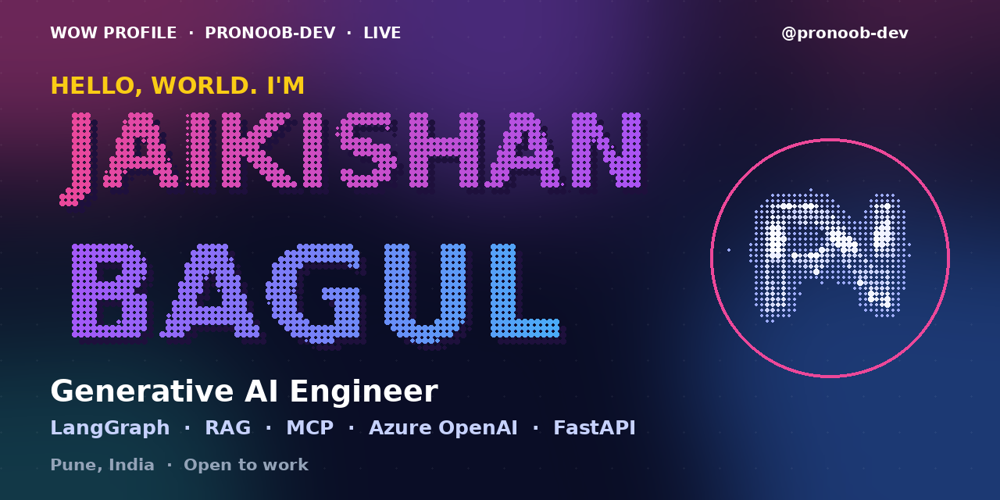

**Generative AI Engineer** · Pune, India

Building production LLM systems and sharing the work in public.

[GitHub](https://github.com/ProNoob-Dev)

> ✦ ───────────────────────────── ✦

## Identity, with signal

| | |
|---|---|
| Generative AI Engineer with 4+ years building production LLM systems at BDO India — multi-agent workflows, RAG, evals and guardrails. Focus: `LangGraph` · `RAG` · `MCP` · `Azure OpenAI`   Production-first: Docker, CI/CD, observability, human-in-the-loop. I build AI agents in public — 3 open-source repos and counting. | **LIVE SIGNAL** **14** repos &nbsp; **0** stars &nbsp; **101** contributions &nbsp; **0** followers |

> ✦ ───────────────────────────── ✦

## What moves the work

Production judgement over demos — evals, observability, guardrails, durable execution, and agents that hold up under real client work.

> ✦ ───────────────────────────── ✦

## The tools behind the signal

Python · FastAPI · LangGraph · RAG · MCP · Azure OpenAI · Qdrant · pgvector · Docker · Azure — chosen for the work, not the trend.

> ✦ ───────────────────────────── ✦

## Built, shipped, shared

| Project | What it does |
|---|---|
| [ai-multi-agent-workflow-engine](https://github.com/ProNoob-Dev/ai-multi-agent-workflow-engine) | Multi-agent workflow engine — LangGraph router, domain agents, MCP tools, human-in-the-loop gates for financial actions, compensating sagas, Langfuse evals   Python · ⭐ 0 |
| [ai-kyc-client-onboarding-agent](https://github.com/ProNoob-Dev/ai-kyc-client-onboarding-agent) | AI agent that verifies KYC documents for client onboarding — classification, field extraction and validation, PII masking, human review queue   Python · ⭐ 0 |
| [ai-insurance-claims-triage-agent](https://github.com/ProNoob-Dev/ai-insurance-claims-triage-agent) | AI agent that triages insurance claims — document ingestion, policy RAG, anomaly scoring, human-in-the-loop   Python · ⭐ 0 |
| [ProNoob-Dev](https://github.com/ProNoob-Dev/ProNoob-Dev) | GitHub profile README — Generative AI Engineer   Open source · ⭐ 0 |

> ✦ ───────────────────────────── ✦

## Momentum, made visible

  
  

  

> ✦ ───────────────────────────── ✦

## The trail behind the work

2 day current streak · 24 active days

> ✦ ───────────────────────────── ✦

KEEP THE SIGNAL MOVING

## Make something worth noticing

I like working with people who care about craft, context, and shipping the useful version.

  
  

[GitHub](https://github.com/ProNoob-Dev)

---
Jaikishan Bagul · Wow-inspired profile
---

